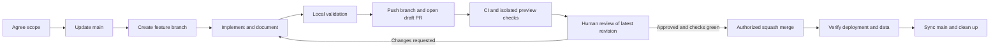

# Branch, review and merge workflow

## Branch policy

`main` contains reviewed release-ready changes. Work on one branch per task: `feat/<short-topic>`, `fix/<short-topic>`, `docs/<short-topic>`, or `chore/<short-topic>`. Names should describe the task and must not contain taxpayer names, emails or other private data. Avoid long-lived develop branches and unrelated changes in the same PR.



## 1. Start from current main

First inspect git status and preserve unrelated local edits. Do not stash, reset, clean or delete someone else's work automatically. Commit it on its appropriate branch or use a separate worktree when needed.

With a clean checkout:

```sh
git switch main
git pull --ff-only origin main
git switch -c feat/your-topic
```

Use a task-appropriate name. Inspect AGENTS.md and architecture before implementation. Define acceptance criteria and decide whether UI, API, schema, stored plans, calculations, exports or environment configuration are affected. Future agents must use AI_TASK_TEMPLATE.md for a short plan/handoff when helpful.

## 2. Implement and validate

Preserve calculation boundaries and legacy data behavior unless an explicit request changes them. Update documentation with the implementation, not after the PR is approved. Use synthetic data and a separate development database.

Run:

```sh
npm test
npm run typecheck
npm run build
git diff --check
git diff --stat
git status --short
```

Also exercise affected user workflows. UI changes need browser evidence; schema changes need a reviewed forward migration and rollback/data-preservation plan; calculation changes need explicit authorization and independent expected results. A green build alone does not establish parity or database correctness. Do not reapply the original schema bootstrap to an existing database.

Stage and review only intended files. Keep secrets, .env.local, customer data, browser backups, build output and dependency folders out of Git. Use .env.example for variable names/placeholders. Preserve the existing source-integrity baseline; document authorized exceptions without regenerating original engine expectations from changed code.

```sh
git add path/to/changed-file
git diff --cached
git commit -m "feat: describe the resulting behavior"
git push -u origin feat/your-topic
```

Do not force-push main. If a branch is shared, prefer merging origin/main into it; do not rewrite another contributor's commits. Rebasing your private branch is optional, but coordinate before a force-with-lease update and do not do it merely to silence a conflict.

## 3. Open and review a PR

Open a draft PR with base main and the feature branch as head. Use .github/PULL_REQUEST_TEMPLATE.md. Describe the problem/result, validation, relevant risks, schema/environment requirements, rollout and rollback. Attach synthetic-data screenshots for UI work. Request the appropriate human reviewer; CODEOWNERS identifies the repository owner.

CI workflow `CI` runs job `validate` on PRs to main and main pushes. It installs locked dependencies, runs parity/connection tests, typechecks and builds without database credentials. Official actions are pinned to verified release commit SHAs. Do not add production secrets to PR CI, use pull_request_target to run untrusted code, or broaden workflow token permissions for a normal feature.

Mark ready for review only when the latest commit has green checks and the acceptance evidence is ready. Address feedback on the same branch. New code commits require renewed approval, including when a previously reviewed conflict resolution changes behavior.

## 4. Approval is a gate

Merge requires all of the following:

1. A human reviewer approved the latest reviewed revision and no outstanding changes-requested review remains.
2. The latest `validate` check passed, required checks are complete, and review conversations are resolved.
3. The branch has no merge conflict, documentation is current, and any database/environment rollout has been reviewed.
4. The maintainer has authorized merging that PR. Approval from a chat is not a GitHub review, and GitHub's required review rules still apply.

AI agents may prepare branches and PRs within their task authorization. They must stop at the review gate, report the PR/check status, and wait for human approval/merge authorization. They must not self-approve, infer approval from silence, bypass branch protection, lower required reviews, enable auto-merge to bypass review, or push the feature commit directly to main.

GitHub does not count the author's own approving review. If Xghayor authored a PR and the repository requires one GitHub approving review, another eligible collaborator must review it. Do not weaken the rule to work around that limitation. Add an appropriate reviewer/collaborator deliberately, with the owner's approval.

## 5. Merge and release

After the gate is satisfied, an authorized maintainer uses squash merge. Confirm the intended base, latest head SHA, approval state and checks at merge time. Never merge a stale reviewed revision after new commits. Keep the PR link and resulting main commit in the handoff.

Follow RELEASE_CHECKLIST.md. When GitHub is connected to Vercel, main may deploy automatically; a merge is therefore a release action. Production uses its own server-only DATABASE_URL. Preview branches use a separate test database and synthetic data, not live taxpayer records.

Once the merge and production checks succeed:

```sh
git switch main
git pull --ff-only origin main
```

Delete the feature branch only when its work is confirmed in main and no unmerged work remains. A squash merge may cause git branch -d to report unmerged commits despite a merged PR; inspect the merged PR and compare before deleting. Do not bypass this safeguard blindly.

## Repository owner setup

Markdown and CODEOWNERS communicate policy; branch protection/rulesets enforce it. For main, configure these in GitHub Settings → Rules/Rulesets or Branches:

- Require a pull request and at least one approving review.
- Dismiss stale approvals after code changes, require approval of the latest reviewable push when supported, and resolve conversations.
- Require status check `validate` from the CI workflow. Enable it after the first successful CI run makes the check selectable. Prefer requiring the branch to be up to date.
- Block force pushes and branch deletion. Apply the rules to administrators/disable bypass where the plan supports it.
- Allow squash merges and automatic deletion of merged head branches if desired; do not enable unrestricted auto-merge.

CODEOWNERS alone does not enforce approval. GitHub's free plan supports protected branches for public repositories; private repository enforcement may require a paid plan. Do not change visibility or subscribe to a plan as a workaround. See [GitHub branch protection documentation](https://docs.github.com/en/repositories/configuring-branches-and-merges-in-your-repository/managing-protected-branches).

Record actual configured settings in REPOSITORY_STATUS.md. Do not describe an unconfigured rule, unobserved approval or unrun CI check as enforced/passed. Bootstrap for this migration is a feature branch PR against the existing initial README commit; main must remain unchanged until that PR is reviewed and authorized for merge.
